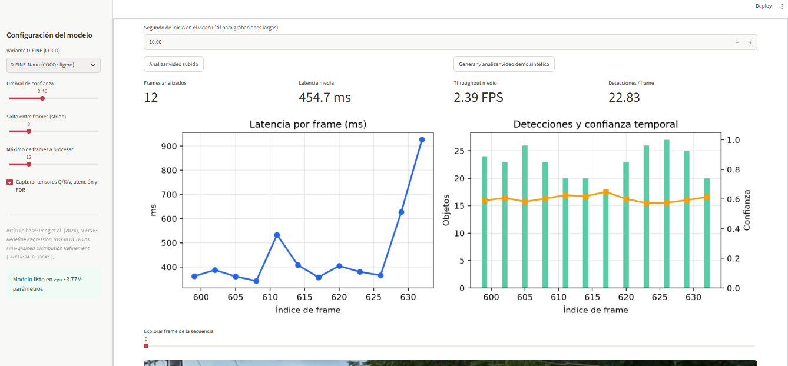
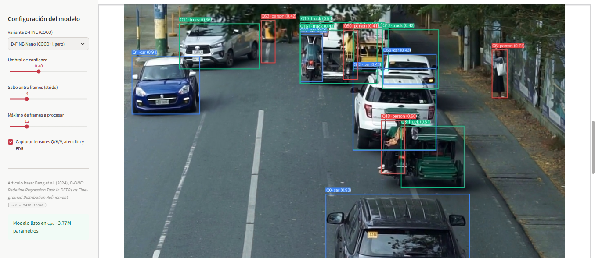
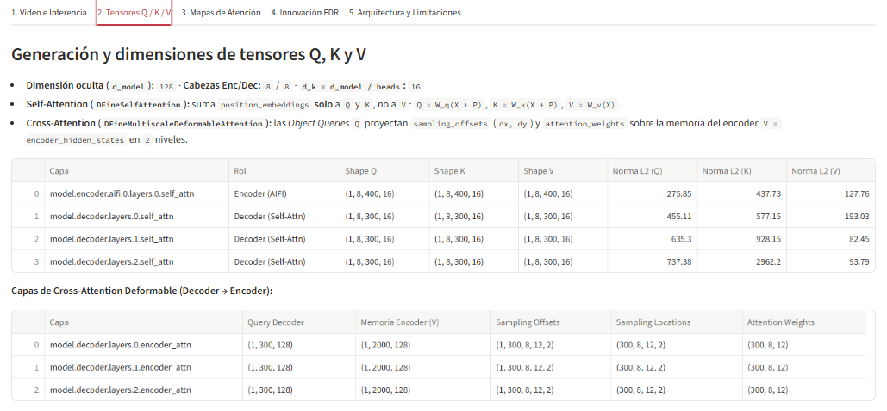
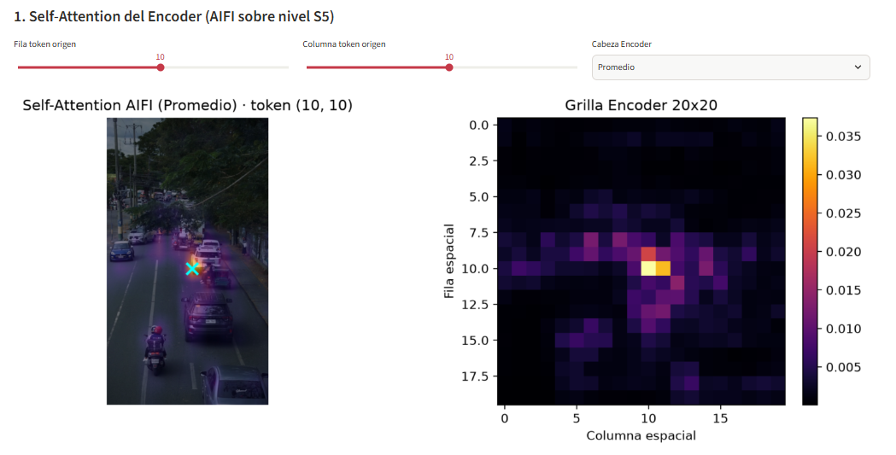
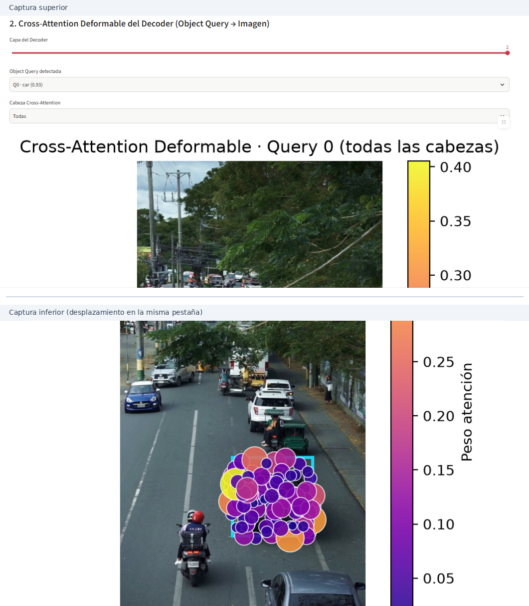
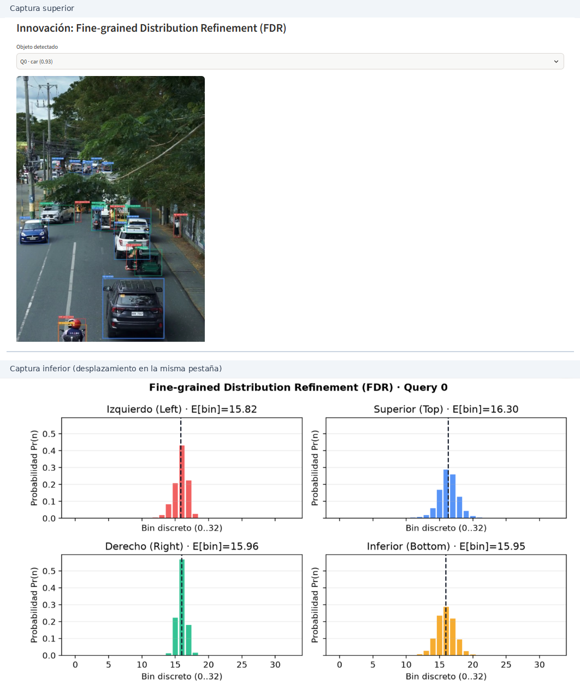

<div align="center">

# Proyecto Final Secuencial — D-FINE en Video

**Inferencia, análisis de atención Q/K/V y visualización interactiva de D-FINE (Transformer Encoder-Decoder) sobre secuencias de video.**

[](https://opensource.org/licenses/MIT)
[](https://www.python.org/downloads/)
[](https://github.com/JoseLuqueC/proyecto-final-secuencial/actions/workflows/ci.yml)
[](https://github.com/astral-sh/uv)
[](https://github.com/astral-sh/ruff)
[](./.pre-commit-config.yaml)
[](https://conventionalcommits.org)

</div>

---

## 📑 Tabla de contenidos

- [1. Resumen (Abstract)](#1-resumen-abstract)
- [2. Introducción](#2-introducción)
- [3. Marco teórico](#3-marco-teórico)
- [4. Metodología](#4-metodología)
- [5. Desarrollo e implementación](#5-desarrollo-e-implementación)
- [6. Resultados y análisis](#6-resultados-y-análisis)
- [7. Conclusiones](#7-conclusiones)
- [8. Referencias](#8-referencias)
- [Estructura y automatización](#-estructura-y-automatización)

---

## 1. Resumen (Abstract)

Este proyecto implementa el flujo completo de inferencia e inspección interna de **D-FINE**
(*Fine-grained Distribution Refinement* for DETRs) aplicado al procesamiento secuencial de video.
A diferencia de enfoques basados en regresión directa de coordenadas rígidas, D-FINE reformula la
localización de cajas dentro de una arquitectura **Transformer Encoder–Decoder** mediante
refinamiento iterativo de distribuciones discretas de probabilidad (FDR) y estimación de calidad de
localización (LQE). El repositorio instrumenta *forward hooks* en PyTorch sobre `DFineForObjectDetection`
para capturar en tiempo de inferencia las dimensiones reales de los tensores `Q`, `K` y `V`, los
mapas de *Self-Attention* del encoder (`AIFI`), los puntos de muestreo de *Cross-Attention
Deformable* del decoder y las distribuciones FDR, exponiendo todo en una aplicación interactiva de
Streamlit.

---

## 2. Introducción

- **Artículo base:** Y. Peng, H. Li, P. Wu, Y. Zhang, X. Sun y F. Wu, *"D-FINE: Redefine
  Regression Task in DETRs as Fine-grained Distribution Refinement"*, `arXiv:2410.13842`, 2024.
- **Repositorio original:** [`Peterande/D-FINE`](https://github.com/Peterande/D-FINE) y pesos
  preentrenados oficiales integrados en Hugging Face `transformers` bajo
  [`ustc-community/dfine_n_coco`](https://huggingface.co/ustc-community/dfine_n_coco) (junto con
  las variantes `s`, `m`, `l` y `x`).
- **Contexto del problema y motivación:** Los detectores basados en *DEtection TRansformer* (DETR)
  eliminaron etapas heurísticas como *anchors* y *Non-Maximum Suppression* (NMS), pero suelen sufrir
  baja precisión en bordes ambiguos o movimiento rápido al regresar cuatro escalares rígidos
  `(cx, cy, w, h)`. En secuencias de video en tiempo real, esta rigidez degrada la estabilidad de
  las detecciones frame a frame.
- **Objetivo:** Comprender e implementar el pipeline de inferencia de D-FINE sobre secuencias de
  video, desglosar la generación de tensores `Q`, `K`, `V` y las innovaciones del modelo, y
  ofrecer una interfaz interactiva que permita inspeccionar predicciones, mapas de atención y
  métricas de desempeño.

---

## 3. Marco teórico

### Arquitectura Encoder–Decoder de D-FINE

1. **Preprocesamiento y Backbone (`HGNetv2`):** Cada frame RGB `(H, W, 3)` se normaliza y
   redimensiona a tensor `(B, 3, H', W')`, extrayendo mapas de características multiescala.
2. **Encoder Híbrido (`DFineHybridEncoder`):**
   - **AIFI (`DFineSelfAttention`):** Aplica *Multi-Head Self-Attention* denso únicamente sobre el
     mapa de mayor nivel semántico (`S5`, grilla `20×20 = 400` tokens en `dfine_n_coco`) para
     reducir costo cuadrático.
   - **CCFF (Cross-scale Feature Fusion):** Bloques convolucionales (`RepNCSPELAN4`, `SCDown`)
     fusionan múltiples escalas en la secuencia de memoria `encoder_hidden_states`.
3. **Decoder Transformer (`DFineDecoder`):**
   - Selecciona los top-`300` *Object Queries* iniciales desde la salida del encoder.
   - Cada capa (`DFineDecoderLayer`) ejecuta:
     1. **Decoder Self-Attention (`DFineSelfAttention`):** Las 300 queries interactúan entre sí
        para evitar predicciones duplicadas.
     2. **Decoder Cross-Attention (`DFineMultiscaleDeformableAttention`):** Cada query atiende
        puntos muestreados de forma dispersa en los niveles multiescala del encoder, integrando la
        residual mediante una compuerta `DFineGate`.

### Generación de tensores `Q`, `K` y `V`

- **En Self-Attention (`DFineSelfAttention`):** D-FINE suma los *positional embeddings* sinusoidales
  2D (`P`) únicamente a las entradas de *Query* y *Key*, preservando el contenido puro en *Value*:
  - `Q = W_q(X + P)`
  - `K = W_k(X + P)`
  - `V = W_v(X)`
  - Atención escalada: `Attn(Q, K, V) = softmax((Q · K^T) / sqrt(d_k)) · V`
  - Para `dfine_n_coco` (`d_model = 128`, `8` cabezas, `d_k = 16`):
    - Encoder AIFI: `Q, K, V` con forma `(1, 8, 400, 16)`.
    - Decoder Self-Attention: `Q, K, V` con forma `(1, 8, 300, 16)`.
- **En Cross-Attention Deformable (`DFineMultiscaleDeformableAttention`):** En lugar de calcular una
  matriz densa `Q × K^T` de `300 × N_encoder`, el estado del query `X_q + P_q` proyecta mediante
  capas lineales `sampling_offsets` (`Δx, Δy`) alrededor de `reference_points` y `attention_weights`
  normalizados con `softmax`, muestreando bilinearmente sobre `V = encoder_hidden_states` en `12`
  puntos por cabeza (`6` puntos × `2` niveles multiescala en `dfine_n_coco`).

### Innovaciones principales

- **FDR (Fine-grained Distribution Refinement):** Cada capa del decoder refina residualmente
  distribuciones discretas de probabilidad sobre `33` bins (`0..32`) para los cuatro bordes
  `(Izquierdo, Superior, Derecho, Inferior)` de cada caja; la capa `DFineIntegral` calcula la
  ubicación esperada `sum(Pr(n) · W(n))`.
- **GO-LSD (Global Optimal Localization Self-Distillation):** Durante el entrenamiento, la última
  capa del decoder destila sus distribuciones finas hacia capas intermedias para acelerar
  convergencia sin costo adicional en inferencia.
- **LQE (Localization Quality Estimation):** Evalúa los valores `top-k` de las distribuciones FDR
  para calibrar los *scores* de clasificación según la certeza geométrica del borde.

---

## 4. Metodología

- **Gestión reproducible:** Entorno aislado con [`uv`](https://docs.astral.sh/uv/) sobre Python
  3.13+ (`uv.lock` versionado; prohibido `pip` y `requirements.txt`).
- **Carga de pesos preentrenados:** Consumo directo de modelos oficiales `ustc-community/dfine_*_coco`
  mediante `AutoImageProcessor` y `DFineForObjectDetection` en Hugging Face `transformers`,
  configurados con `attn_implementation="eager"` para habilitar la extracción real de pesos de
  atención sin modificar parámetros.
- **Instrumentación no invasiva:** Registro temporal de *PyTorch forward hooks* en
  `src/seq_transformer/inspector.py` para capturar estadísticas `Q/K/V`, offsets deformables y
  distribuciones FDR durante inferencia (`torch.no_grad()`).
- **Procesamiento secuencial e interfaz:** Muestreo de video frame a frame con OpenCV (`stride` y
  `max_frames` configurables) y visualización interactiva en Streamlit.

---

## 5. Desarrollo e implementación

### Requisitos previos

- Python 3.13+
- [`uv`](https://docs.astral.sh/uv/getting-started/installation/)
- Git

### Instalación y ejecución

```bash
git clone https://github.com/JoseLuqueC/proyecto-final-secuencial.git
cd proyecto-final-secuencial

# 1. Instalar dependencias y hooks de pre-commit
#    Usa `--extra cpu` (sin GPU) o `--extra cuda` (NVIDIA GPU local; equivalente a `make dev-cuda`)
uv sync --all-groups --extra cpu
# O con GPU NVIDIA: make dev-cuda
uv run python -m pre_commit install

# 2. Verificar calidad, tipos y pruebas offline
make check

# 3. Ejecutar interfaz interactiva en Streamlit
make app
```

### Arquitectura del código (`src/seq_transformer/`)

| Módulo | Responsabilidad |
|--------|-----------------|
| [`models.py`](src/seq_transformer/models.py) | Catálogo `DFINE_MODELS`, selección automática CPU/CUDA y carga en modo `eval()`. |
| [`inspector.py`](src/seq_transformer/inspector.py) | `DFineInspector` con hooks sobre `DFineSelfAttention`, `DFineMultiscaleDeformableAttention` y `DFineIntegral`. |
| [`video.py`](src/seq_transformer/video.py) | Extracción secuencial de frames, inferencia por frame y cálculo de métricas temporales. |
| [`visualization.py`](src/seq_transformer/visualization.py) | Render de cajas con `query_index`, mapa `AIFI`, puntos deformables, curvas FDR y series temporales. |
| [`app.py`](src/seq_transformer/app.py) | Dashboard Streamlit con 5 pestañas para demo en vivo y sustentación. |

---

## 6. Resultados y análisis

### Verificación en ejecución real (`ustc-community/dfine_n_coco`, CPU)

Prueba ejecutada localmente con `attn_implementation="eager"` e instrumentación activa de hooks sobre
una secuencia sintética de `640×360`:

| Métrica / Tensor observado | Valor medido |
|----------------------------|--------------|
| Parámetros totales (`dfine_n_coco`) | `3,770,421` (~3.77M) |
| Latencia promedio (CPU + hooks activos) | `123.2 ms / frame` (`8.35 FPS`) |
| Tensores `Q, K, V` Encoder AIFI | `(1, 8, 400, 16)` |
| Tensores `Q, K, V` Decoder Self-Attention (×3 capas) | `(1, 8, 300, 16)` |
| `sampling_locations` Cross-Attention | `(300, 8, 12, 2)` |
| `attention_weights` Cross-Attention | `(300, 8, 12)` |
| Distribuciones FDR (`DFineIntegral`) | `(300, 4, 33)` |

> 📸 **Capturas de prueba en interfaz:** Ejecuta `make app`, carga un video real `.mp4` en la
> pestaña **1. Video e Inferencia**, explora las pestañas **2–4** y adjunta aquí tus capturas de
> pantalla propias en `docs/assets/` antes de la sustentación.

### Validación complementaria con video real (25 de noviembre de 2026)

Además de la prueba sintética documentada arriba, se analizó un video real de
tráfico urbano usando **D-FINE-Nano sobre CPU** y captura de tensores internos.
Esta ejecución es independiente de la prueba sintética; sus cifras no deben
compararse directamente sin controlar las condiciones experimentales.

| Configuración | Valor |
|---|---|
| Modelo | `ustc-community/dfine_n_coco` |
| Escena | Tráfico urbano (automóviles, motocicletas y personas) |
| Segundo inicial (`start_sec`) | `10.0` |
| Salto entre frames (`stride`) | `3` |
| Máximo de frames | `12` |
| Umbral de confianza | `0.40` |
| Captura de Q/K/V, atención y FDR | Activada |

| Métrica observada | Resultado |
|---|---:|
| Frames procesados | `12` |
| Latencia media por frame | `454.7 ms` |
| Media de FPS instantáneos mostrada por la aplicación | `2.39 FPS` |
| Detecciones promedio por frame | `22.83` |

La selección `start_sec=10` permitió iniciar el análisis alrededor del frame
`600` del video utilizado. El valor de FPS es un promedio de tasas instantáneas
calculadas a partir de las latencias; **no es una medición de FPS de reproducción
continua del video**. Las puntuaciones de confianza tampoco equivalen a una
medición de precisión o mAP, que requeriría anotaciones de referencia.

**Evidencias visuales de la ejecución:**

**1. Métricas temporales de inferencia**



**2. Detecciones de objetos sobre un fotograma**



**3. Dimensiones y normas de tensores Q/K/V**



**4. Mapa de Self-Attention AIFI del encoder**



**5. Muestreo de Cross-Attention Deformable del decoder**



**6. Distribuciones discretas FDR de la Object Query 0**



En la captura FDR, los valores esperados de los bins para la query seleccionada
fueron: izquierdo `15.82`, superior `16.30`, derecho `15.96` e inferior `15.95`.
Son posiciones en la representación interna de bins, no coordenadas en píxeles.

### Validación adicional de calidad y pruebas

En Windows, con Python `3.13.15`, se ejecutaron las verificaciones siguientes:

```powershell
uv run ruff check .
uv run ruff format --check .
uv run python -m compileall -q src tests
uv run pytest -v
```

El resultado registrado fue **12 pruebas aprobadas** (cinco existentes y siete
agregadas en `tests/test_video_start_sec.py`), con Ruff sin errores y
`19` archivos correctamente formateados. Las pruebas nuevas cubren muestreo desde
el inicio y desde un segundo específico, inicio posterior a la duración, valores
inválidos de `stride`, `max_frames` y `start_sec`, y video inexistente.

Estas pruebas no reemplazan una evaluación de detección con etiquetas reales ni
una prueba automatizada de extremo a extremo de la interfaz Streamlit.

---

## 7. Conclusiones

- **Aprendizajes clave:** La inspección directa de `DFineSelfAttention` y
  `DFineMultiscaleDeformableAttention` demuestra cómo D-FINE combina *Self-Attention* denso en baja
  resolución (`20×20`) con atención deformable dispersa en el decoder, manteniendo 300 *Object
  Queries* y modelando incertidumbre geométrica mediante distribuciones discretas (FDR).
- **Limitaciones:**
  1. **Sin memoria temporal inter-frame:** Cada frame se procesa de forma independiente sin propagar
     estados ocultos ni identidades entre `t-1` y `t`.
  2. **Vocabulario cerrado:** Los pesos públicos están entrenados en 80 clases de COCO.
  3. **Modo `eager` vs `sdpa`:** La extracción de matrices completas `encoder_attentions` y
     `decoder_attentions` requiere `attn_implementation="eager"`, añadiendo sobrecarga frente a `sdpa`.
- **Mejoras futuras:** Integrar propagación temporal de queries entre frames consecutivos (estilo
  TrackFormer/MeMOTR), exportar a ONNX/TensorRT para inferencia acelerada en GPU y habilitar
  selección de pesos propios mediante *fine-tuning* ligero.

---

## 8. Referencias

[1] Y. Peng, H. Li, P. Wu, Y. Zhang, X. Sun, and F. Wu, "D-FINE: Redefine Regression Task in DETRs
as Fine-grained Distribution Refinement," *arXiv preprint arXiv:2410.13842*, 2024. [Online].
Available: https://arxiv.org/abs/2410.13842

[2] N. Carion, F. Massa, G. Synnaeve, N. Usunier, A. Kirillov, and S. Zagoruyko, "End-to-End Object
Detection with Transformers," in *Proc. European Conference on Computer Vision (ECCV)*, 2020,
pp. 213–229.

[3] X. Zhu, W. Su, L. Lu, B. Li, X. Wang, and J. Dai, "Deformable DETR: Deformable Transformers for
End-to-End Object Detection," in *Proc. International Conference on Learning Representations (ICLR)*,
2021.

[4] Y. Zhao, W. Lv, S. Xu, J. Wei, G. Wang, Q. Dang, Y. Liu, and J. Chen, "DETRs Beat YOLOs on
Real-time Object Detection," in *Proc. IEEE/CVF Conference on Computer Vision and Pattern
Recognition (CVPR)*, 2024.

[5] A. Vaswani et al., "Attention Is All You Need," in *Advances in Neural Information Processing
Systems (NeurIPS)*, vol. 30, 2017.

[6] Hugging Face, "D-FINE Model Documentation (`transformers`)," 2025. [Online]. Available:
https://huggingface.co/docs/transformers/main/en/model_doc/d_fine

---

## 🛠️ Estructura y automatización

```text
proyecto-final-secuencial/
├── src/seq_transformer/     # código fuente (models, inspector, video, visualization, app)
├── tests/                   # pruebas unitarias offline con pytest (patrón AAA)
├── docs/                    # documentación, ADRs y notas de investigación
├── CONSTITUTION.md          # fuente única de verdad del proyecto
├── README.md                # documentación académica e instrucciones
├── Makefile                 # make app · make check · make lint · make test
├── pyproject.toml           # metadatos y dependencias (uv)
├── .pre-commit-config.yaml  # higiene + detect-private-key + detect-secrets + Ruff + uv-lock
└── uv.lock                  # lockfile determinista
```

> 📘 Lee [`CONSTITUTION.md`](./CONSTITUTION.md) y [`CONTRIBUTING.md`](./CONTRIBUTING.md) antes de
> abrir un Pull Request. Licencia [MIT](./LICENSE).
